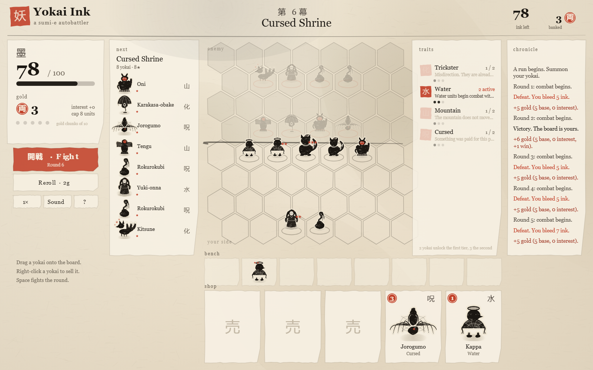
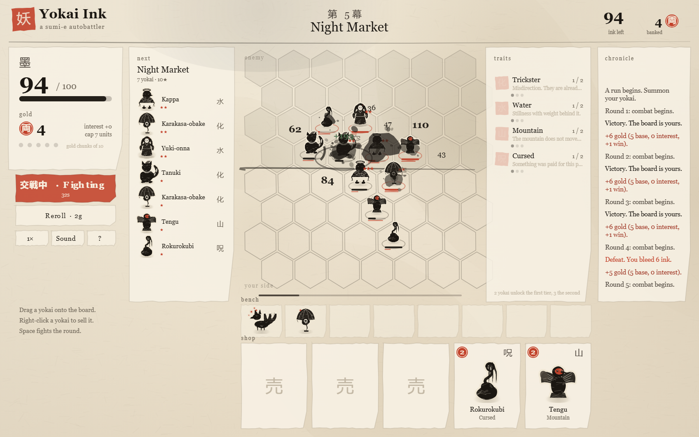
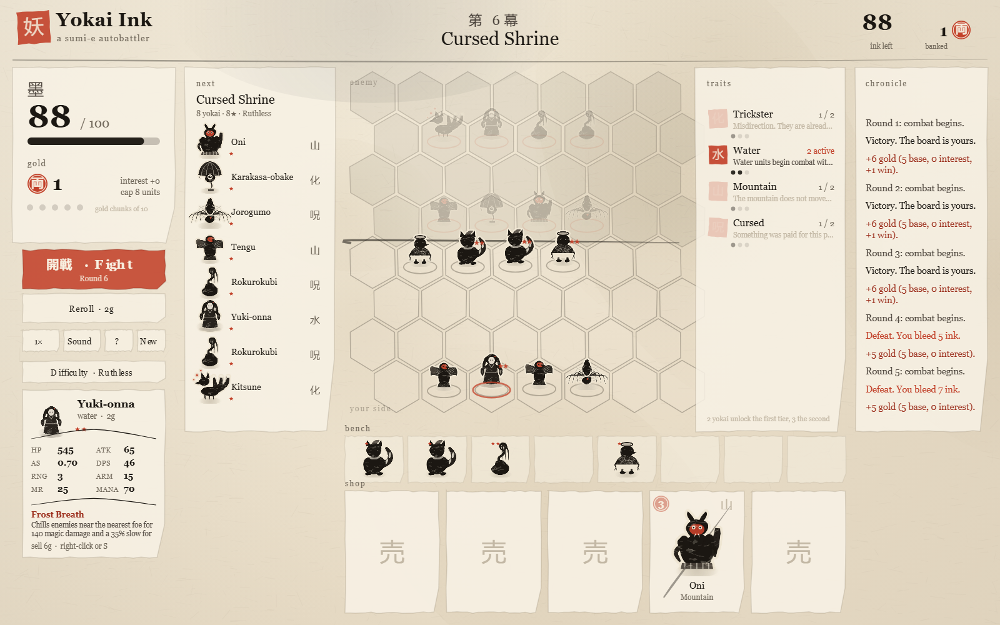
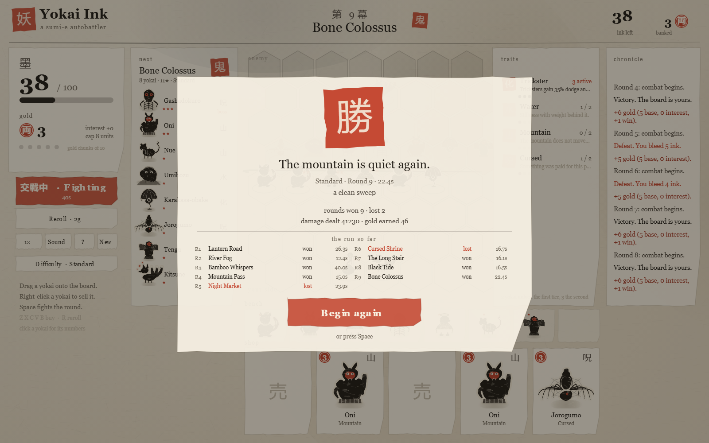

# Yokai Ink

A small sumi-e autobattler that runs in a browser tab. Draft yokai from a five-card
shop, arrange them on a hex board, and watch an ink-and-paper fight resolve on its
own. Eight rounds, then a boss.

Everything is drawn in code — no image assets, no engine, no dependencies, no build
step for development.



| A fight | A stat card |
| --- | --- |
|  |  |



## Play it

**Easiest:** double-click `yokai-ink.html`. It is one self-contained file (CSS, all
23 modules, and the art code inlined) and runs straight off `file://`.

**As source:** serve the folder over HTTP and open `index.html`:

```
node serve.mjs          # http://127.0.0.1:5173
```

`index.html` loads real ES modules, so it needs the server (browsers refuse module
imports from `file://`). After editing source, rebuild the single file with:

```
node tools/build-single-file.mjs
```

Tests run on the bare Node binary with no install step:

```
node tests/sim.test.js
```

## Controls

| Input | Action |
| --- | --- |
| drag a shop card | buy it; drop on a hex to place it there, or on the bench |
| drag a unit | move between hexes and bench slots; drop on the shop strip to sell |
| click a shop card | buy to the first free bench slot |
| click a yokai | open its stat card; click empty paper to close it |
| right-click a unit | sell for its full cost |
| `Space` / `Enter` | fight, then continue |
| `Z` `X` `C` `V` `B` | buy shop slots 1-5 without the mouse |
| `R` | reroll the shop (2 gold) |
| `D` | cycle difficulty (before your first purchase) |
| `1` `2` `4` | combat speed |
| `S` / `Delete` | sell the selected unit |
| `M` | mute |
| `?` | controls and rules |
| `New` (twice) | abandon the run and start over |

The run is saved after every round (and whenever you spend gold), so closing the
tab or refreshing resumes exactly where you left off. `New` needs two presses
inside four seconds, so a stray click cannot wipe a run.

**Stat card.** Click any yokai — on the board or the bench — and the left rail
replaces its hint text with that unit's numbers: health, attack, attack speed,
DPS, range, armour, magic resist and mana, plus its ability at the current star
level and what selling it returns. These are the live values the fight uses
(`hpAtStar`, `attackAtStar`, trait modifiers applied), not the base stats.

**Difficulty.** Story / Standard / Ruthless scale enemy health and attack by
0.9 / 1.0 / 1.1. It can only change before your first purchase, and it is carried
into the next run when you press `Begin again`.

## Rules

- You start with **100 ink** and **5 gold**. Losing a round costs `2 + surviving
  enemies` ink. At 0 ink the run ends.
- The board is 7×4 per side. Your half is the lower four rows; the unit cap is
  `min(round + 2, 8)`.
- Buying three copies of a yokai merges them into the next star level, up to ★★★;
  each star multiplies health and attack by 1.8 and upgrades the ability.
- Twelve yokai, four traits. Two distinct yokai of a trait unlock its first tier,
  three its second — duplicates do not count.
- Income after each round: 5 gold, plus 1 per 10 gold banked (max 5), plus 1 for a
  win. Selling refunds exactly what you paid, including merged copies.
- Rounds 1–8 escalate; round 9 is the Bone Colossus.

## Design notes

**Deviation from the draft:** a win pays +1 gold (`CFG.winBonus`). The draft
economy had no reward for winning a round, which made the mid ladder feel
pointless; set `winBonus` to 0 in `src/config.js` for the strict version.

**Difficulty is data, not hand-tuning.** `src/data/ladder.js` describes each round
as a squad plus two numbers: `budget` (which star levels the enemy can afford) and
`scale` (a multiplier on all enemy health and attack, i.e. stage pressure). Squad
sizes mirror the player's cap so fights are body-for-body. The curve was fitted
with `tools/solve.mjs`, which binary-searches `scale` per round against a target
win rate and prints the table to paste back in.

**Difficulty is one multiplier, not three ladders.** The curve above is fitted
once; a preset multiplies every enemy's health and attack, so Story and Ruthless
are the same fights at 90 % and 110 % pressure. That keeps the shaping of the
ladder (round 6 spikes, the boss is a wall) intact on all three, and it means
`tools/solve.mjs` only ever has to fit one curve. `src/data/difficulty.js` is the
single place to add a fourth preset.

Measured with `tools/presets.mjs` (36 runs each, greedy bot):

| Preset | Runs cleared | Boss win |
| --- | --- | --- |
| Story (×0.9) | 34/36 | 47 % |
| Standard (×1.0) | 30/36 | 31 % |
| Ruthless (×1.1) | 23/36 | 11 % |

**The end screen replays the run.** `state.history` keeps one row per round —
ladder name, won or lost, duration — and the overlay prints it as a two-column
ledger beside the totals, so a defeat shows exactly which round broke the run.

**The simulation is DOM-free.** `src/combat.js` is a fixed-timestep sim (1/60 s)
that never touches the canvas, which is why `tests/sim.test.js` can run thousands
of fights in Node. All randomness comes from a seeded mulberry32, so the same seed
and board always produce the same fight.

**Pace is three numbers.** Early builds had fights that ran the clock out; the fix
was not to shorten the clock but to change what the clock measures:

| Knob | Value | Why |
| --- | --- | --- |
| `CFG.hpScale` | 0.55 | Health is cut globally, so every fight is shorter without touching relative unit power (both sides scale together). |
| `CFG.manaHeadStart` | 0.45 | Units start with part of their mana bar, so the first ability lands ~2 s in instead of ~5 s. |
| `CFG.moveSpeedScale` | 1.25 | Less of a short fight spent walking into range. |

Measured with `tools/pace.mjs` over the whole ladder: the median fight went from
**28 s to 15 s**, timeouts from **16 % to ~0 %**, and the first ability from
**4.1 s to 2.2 s**. Because the ladder's `scale` multiplies health and attack
together, the difficulty targets survived the change once `tools/solve.mjs` was
re-run.

**Spectacle lives in the effects layer.** Damage numbers scale with the hit
(a 12 is quiet, a 300 is vermilion); splats fly along the line of the blow;
deaths collapse into a blot with ink running down the page; a cast blooms its
trait kanji behind the caster; the page shudders by two pixels when something
dies. Sprites are eroded with a `destination-out` dry-brush pass so a silhouette
reads as a loaded brush rather than a vector fill, and each one gets a pale paper
rim so neighbouring units never merge into one black shape.

**Art is procedural ink.** `src/render/ink.js` has the sumi-e toolkit (paper
texture, Catmull-Rom brush ribbons with bristle strands, washes, splats, vermilion
hanko seals). `src/render/sprites.js` paints the twelve yokai from primitives onto
256×256 canvases, which are then drawn as black ink over paper. There is one seam
for real illustrations: `spriteFor(defId)` returns `{ canvas, span, cy }`, so a PNG
loader can replace it without touching the renderer.

## Layout

```
index.html            dev entry (ES modules, needs a server)
yokai-ink.html        generated single-file build (open directly)
css/style.css         page chrome around the canvas
serve.mjs             zero-dependency static server
src/config.js         every tunable number
src/rng.js            seeded RNG
src/hex.js            pointy-top hex math, BFS, cell centres
src/data/             units, traits, abilities, shop odds, ladder, difficulty
src/board.js          placement, bench, swap and unit-cap rules
src/shop.js           pool, rolls, buying, merging, selling
src/combat.js         the fight simulation
src/ai.js             enemy squads from the ladder
src/state.js          run state: rounds, gold, ink, phases
src/traits.js         trait counting and tier text
src/render/           ink toolkit, sprites, effects, scene
src/ui.js             pointer, keyboard, drag and drop
src/audio.js          procedural WebAudio effects
src/main.js           boot and frame loop
tools/                bundler, balance tools, QA pages
```

## Tooling

| Command | What it does |
| --- | --- |
| `node tools/tune.mjs [runs]` | win rate per round with the greedy bot |
| `node tools/solve.mjs [runs]` | fit `scale` per round to the target curve |
| `node tools/pace.mjs [runs]` | fight duration, timeout rate, ability timing |
| `node tools/presets.mjs [runs]` | win rate per round on each difficulty preset |
| `node tools/build-single-file.mjs` | rebuild `yokai-ink.html` |
| `node tools/brace.mjs <file>` | find unbalanced braces in a broken module |
| `tools/savetest.html` | headless checks for save, restore and the live page (?mode=write|read|app) |

`tools/qa.html?scene=prep|combat|result|victory|gameover|help&round=N&seed=N`
renders a single prepared scene for screenshots; it also takes `&select=1` to open
a stat card and `&difficulty=ruthless` to preview a preset. `tools/uitest.html`
drives the real UI with synthetic pointer events and prints pass/fail — useful
after touching the layout, because it catches click targets drifting away from
what is drawn.

Both were checked with headless Chrome:

```
chrome --headless=new --disable-gpu --window-size=1600,1000 \
       --virtual-time-budget=9000 --screenshot=out.png "http://127.0.0.1:5173/tools/qa.html?scene=combat"
```

## Known limits

- Sound is procedural and intentionally dry; there is no music.
- The AI opponent is a fixed ladder, not an adaptive player.
- Sprites are silhouette-level ink figures, not individual illustrations.
- One board size, one mode. The run persists in `localStorage` as a single slot, so
  two tabs overwrite each other's save.
- Fights are balanced against one greedy bot, so a strong human player will find
  the early rounds easy; `tools/solve.mjs` is the knob if that matters.
